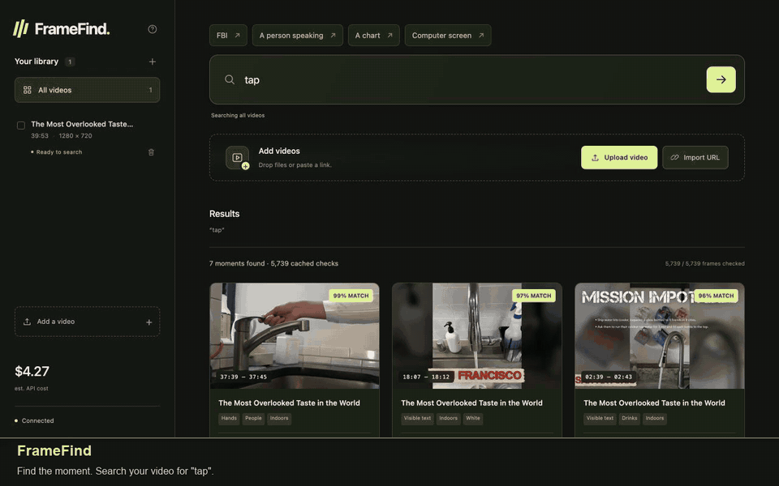

# FrameFind

**Find moments in your videos with natural-language search.**

Upload a clip or paste a public video URL, describe what you want to see, and jump to playable snippets. Built with Python, FFmpeg, and [TypeSafe Jev](https://docs.typesafe.ai/images). Runs on your computer; image analysis uses the TypeSafe API.

[](docs/media/framefind-demo.mp4)

[Watch the MP4 demo](docs/media/framefind-demo.mp4) · [Contribute](CONTRIBUTING.md) · [Architecture](docs/architecture.md) · [CI](https://github.com/Lyadalachanchu/framefind/actions/workflows/ci.yml)

The demo imports [The Most Overlooked Taste in the World](https://www.youtube.com/watch?v=zC1v19wfoTA&t=6s) by **Rabbit Hole** from its YouTube URL, searches for **“tap”**, plays a matching snippet, and exports it. Import, preparation, and pauses are shortened; search reuses saved results from real Jev responses. See [NOTICE](NOTICE.md) for footage credits.

## Try it

You need **Python 3.11+**, **FFmpeg/ffprobe**, and a [TypeSafe API key](https://console.typesafe.ai/). Node.js 22+ is recommended for YouTube downloads.

Install the system dependencies:

- **macOS:** `brew install python ffmpeg node`
- **Ubuntu/Debian:** `sudo apt install python3 python3-venv ffmpeg` on a release with Python 3.11+. Install Node.js 22+ separately for YouTube support.
- **Windows:** use Ubuntu under WSL2. Native Windows is not currently supported.

Then:

```sh
git clone https://github.com/Lyadalachanchu/framefind.git
cd framefind
python3 -m venv .venv
source .venv/bin/activate
python -m pip install -r requirements.txt
python start.py
```

Enter your key at the hidden prompt and open **http://127.0.0.1:8765**. Keep the terminal running; Ctrl+C stops the app. The key is not saved to disk or sent to the browser. On macOS, `./start.command` is an alternative launcher that manages its own environment.

1. **Add a video:** upload a file, paste a direct video URL, or import a public YouTube video.
2. **Describe a moment:** try “a person,” “a red car,” or “a slide with a chart.”
3. **Play or export:** open a matching snippet, loop it, or download an MP4 clip.

To try the same footage as the demo, import [this YouTube video](https://www.youtube.com/watch?v=zC1v19wfoTA&t=6s) and search for **“tap”**. Imports support files up to 2 GB and 60 minutes; short clips are the best starting point. YouTube videos that require sign-in are unsupported, and availability depends on YouTube and yt-dlp.

## What happens when you search?

FFmpeg prepares **every tenth decoded frame** locally, retaining video timestamps. Each new query checks all sampled frames with Jev, including nearby frames for short motion context, with **8 concurrent requests by default**. Matching frames become playable snippets.

The cutoff is fixed at **95% relevance**. This is a normalized model score, not a probability that a result is correct. Repeating the same query reuses saved scores for the same frames and model. A new query takes time and incurs API cost as Jev checks the sampled frames.

Search covers visible scenes, objects, text, and actions, not speech or audio. Sampling can miss brief events, and image analysis can make mistakes. TypeSafe currently describes [image support as a preview feature](https://docs.typesafe.ai/images).

## Privacy and cost

The interface, source videos, extracted frames, and SQLite database stay on your computer. **Search sends sampled images and your query to TypeSafe.** This is a local app with cloud inference, not an offline model. It binds to loopback and has no account system; do not expose it as a public server.

The default model is `jev-1.14.0`. TypeSafe lists **$0.042 per million input tokens**, with free output tokens, as of October 20, 2026. Images contribute input tokens. The app estimates cost from returned usage; the provider's billing is authoritative. [TypeSafe pricing](https://docs.typesafe.ai/models)

A persistent **$15 local spending guard** is enabled by default. It conservatively reserves room for requests and retries, including uncertain charges after interruptions. It only covers this app's data directory, not other uses of your key. Keep the database to preserve its accounting. Search time and cost depend on video length, frame rate, cache coverage, and provider limits.

## Configuration

Set environment variables before starting the app; no `.env` loader is required or included.

| Variable | Default | Purpose |
| --- | --- | --- |
| `TYPESAFE_API_KEY` | Hidden prompt | Your TypeSafe credential |
| `PORT` | `8765` | Local web server port |
| `JEV_DATA_DIR` | `./data` in the project | Videos, frames, caches, and usage records |
| `JEV_BUDGET_USD` | `15` | Lifetime local spending guard in USD |
| `JEV_CONCURRENCY` | `8` | Concurrent requests, clamped to 1–24 |
| `JEV_MODEL` | `jev-1.14.0` | Model identifier; caches are separate per model |

Cost estimation currently uses the rate above. Check provider pricing before selecting a different model. The 95% cutoff and sampling interval are fixed in code.

## Contribute

FrameFind is **MIT licensed**. Bug reports, small fixes, and documentation improvements are welcome. See [CONTRIBUTING.md](CONTRIBUTING.md) for setup and a source map, and [SECURITY.md](SECURITY.md) for private vulnerability reporting.

```sh
python -m pip install -r requirements-dev.txt
python -m pytest -q
node --check app/static/app.js
```

Tests use generated media and mocked provider responses; no API key or paid requests are needed. CI checks Linux and macOS. [Architecture notes](docs/architecture.md) explain preparation, search, caching, and usage accounting. [Sharing notes](docs/sharing.md) include a Show HN draft and demo links.

[MIT license](LICENSE) · [Third-party notices and demo credits](NOTICE.md)
