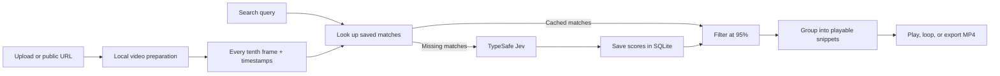

# Architecture

FrameFind is a single-process local application: FastAPI serves the browser UI and HTTP endpoints, FFmpeg handles media, SQLite persists the library, and TypeSafe Jev evaluates visual matches. The frontend is plain HTML, CSS, and JavaScript with no build step.

## Preparation

Uploads are copied into the data directory. Direct public video URLs use HTTP downloads; public YouTube URLs use the installed `yt-dlp` Python module. The importer checks URL destinations and handles download limits, progress, cancellation, and startup timeouts. Imports are limited to 2 GB and 60 minutes.

FFprobe reads video metadata. If the original is unsuitable for browser playback, FFmpeg creates a separate H264/AAC MP4 copy. Sampling always uses the original video, selecting decoded frame numbers **0, 10, 20, …** and retaining their presentation times relative to the first sample. This preserves timing for variable-frame-rate sources.

Sampled JPEGs fit within 640 × 640 pixels, with padding where needed to reach a minimum side of 280 pixels. A frame manifest supports reuse after a restart. Existing complete frames keep their IDs and cached matches; regenerated sequences invalidate affected match caches. Preparation does not call Jev.

## Search and scoring

Every search checks all ready sampled frames in the selected videos. For each target frame, the request includes its previous and next sampled frames when they fall within 1.5 seconds, giving up to three images of short temporal context. Eight workers run by default, and the provider client shares a concurrency limit across requests.

Jev answers one four-level `score` question about visual relevance. The client divides the returned 0–3 score by 3. Results require an unrounded value of at least **0.95**; the displayed percentage is therefore a relevance score, not model confidence or a measured accuracy rate. This is distinct from the provider's separate confidence field. [TypeSafe Score reference](https://docs.typesafe.ai/primitives/score)

Nearby matching frames from the same video become snippets, normally with 1.5 seconds of lead-in and 2 seconds of lead-out. Snippets are at least 3 seconds long where possible and bounded by the source duration. Groups stop when their matching-frame span reaches 20 seconds. The response returns up to 60 snippets ranked by peak relevance. Export transcodes a chosen range into an H264/AAC MP4; the temporary export is removed after serving it.

There is no current label-generation stage or vector index. Older taxonomy helpers and database fields remain for compatibility with existing libraries.

## Persistence and jobs

The default `data/` directory contains:

| Location | Contents |
| --- | --- |
| `index.sqlite3` | Videos, frame metadata, match caches, usage, and budget reservations |
| `videos/<id>/` | Source video, optional playback copy, and sampled frames |
| `clips/` | Temporary MP4 exports |

The database filename is historical; it does not imply a separate AI indexing operation. Match caches include the normalized query, configured model, target frame ID, and neighboring frame IDs. Case and whitespace differences can reuse results. A model change uses separate cache entries.

Search jobs and progress live in process memory. Saved frame scores survive a restart, so rerunning a query can reuse completed work, while the previous job itself is not resumable. Interrupted local preparation becomes paused; interrupted downloads require importing the URL again. Deleting a video cascades its frame/cache records and removes media while retaining historical usage accounting.

## Usage accounting

Before a paid operation, the app reserves enough tokens for all allowed attempts at the default request context limit. Successful usage replaces that reservation. Uncertain charges, including potentially billed server failures or interrupted requests, remain reserved across restarts. This makes the local guard conservative; it may stop before the displayed estimated spend reaches the configured limit.

The UI shows reported input-token cost. The status endpoint also exposes committed budget, including reservations. Both use the rate configured in source, currently $0.042 per million input tokens. The database must be retained for accounting continuity, and the guard cannot see other applications using the same provider key.

## Boundaries and development

The launcher binds to `127.0.0.1`. Middleware rejects unexpected hostnames and cross-origin requests, and the API never returns the credential or stored source path. Keys remain on the server; queries and images leave the machine during inference. See [SECURITY.md](../SECURITY.md).

The app is intended for one local user. It has no authentication, multi-user isolation, distributed job queue, or speech transcription. See [CONTRIBUTING.md](../CONTRIBUTING.md) for the source map and tests. Changes to the request prompt, neighboring-image policy, or scoring semantics should also change the cache version so older scores are not reused under new rules.
